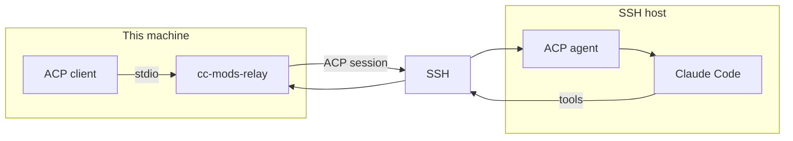
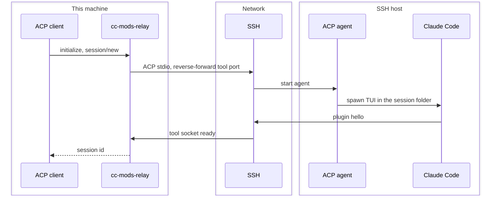

# cc-mods-relay

**Claude Code on an SSH host. Workspace tools stay on this machine.**

An [ACP](https://agentclientprotocol.com) client such as [acpc](https://github.com/agentclientprotocol/acpc) talks to this binary over stdio. The remote side hosts the interactive [Claude Code](https://code.claude.com) TUI. Read, Write, Edit, Glob, Grep, NotebookEdit, and Bash run against the local working directory.

## Architecture

Who runs where. ACP stdio and the tool socket share one SSH connection; they are not the same channel.



## Sequence



## Install

```sh
bun install
bun run compile
bun link
```

On the SSH host: `claude`, `bun`, and preferably `herdr` (Bun 1.4 PTY is used if herdr is missing).

## Configure

```sh
mkdir -p ~/.config/cc-mods-relay
echo your-ssh-host > ~/.config/cc-mods-relay/host
```

The destination is `--host`, then `$CC_MODS_HOST`, then that file. Anything `ssh` accepts works.

Point an ACP client at `cc-mods-relay` (optional `--host`). Without `--host`, the TUI and the tool executor both run locally.

```toml
# acpc config.toml
[[agents]]
slug = "cc"
command = "cc-mods-relay"
args = ["--host", "your-ssh-host"]
```

```sh
cc-mods-relay doctor
```

## Session folder

The host session cwd follows the local project, flattened under `~/Workspace`:

| Local working directory | Host session cwd |
| --- | --- |
| `/Users/you/Workspace/app` | `~/Workspace/app` |
| your home directory | `~/Workspace` |

That folder looks like a normal checkout. `AGENTS.md`, `CLAUDE.md`, `CLAUDE.local.md`, and project `.claude/` skills and commands are copied there so Claude Code loads them at session start. File and shell tools still run on this machine; `session/new` `cwd` is the local path.

`~/.config/cc-mods-relay/config.json` can set `dir` (default `Workspace`). `ws` is `home` by default.

## Tools

| Where | Tools |
| --- | --- |
| This machine | Read, Write, Edit, Glob, Grep, NotebookEdit, Bash, PowerShell |
| Copied to the host, then native | Artifact, DesignSync |
| Not run (no local executor yet) | LSP, Monitor, EnterWorktree, ExitWorktree, SendFile, SendUserFile |
| Host session | Agent, Skill, WebSearch, TodoWrite, and other session/cloud tools |

## Environment

`claude --append-system-prompt-file` (a Claude Code flag) adds the local working directory, git status, `AGENTS.md`, and `CLAUDE.md`. Credentials stay on the host TUI; they are not sent on the ACP wire.
