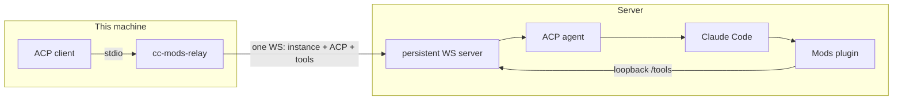
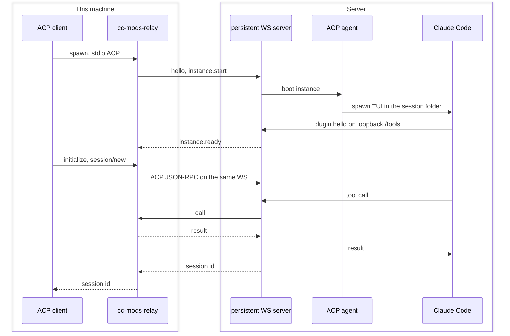

# cc-mods-relay

**Claude Code on a WebSocket server. Workspace tools stay on this machine.**

An [ACP](https://agentclientprotocol.com) client talks to this binary over stdio. A persistent WebSocket server hosts the interactive [Claude Code](https://code.claude.com) TUI. Read, Write, Edit, Glob, Grep, NotebookEdit, and Bash run against the local working directory.

Any two machines that can open a WebSocket between them work.

## Architecture

Who runs where. The ACP client still talks stdio to this binary. One WebSocket to the persistent server carries ACP and our own frames; the Mods plugin stays on loopback on the server.



## Sequence



## Install

```sh
bun install
bun run compile
bun link
```

The server needs `claude` and `bun`.

## Configure

On the machine that should run Claude Code:

```sh
cc-mods-relay serve
```

That writes a token to `~/.config/cc-mods-relay/token` if none is set, and listens on `ws://0.0.0.0:18765` by default.

On this machine, point at that URL:

```sh
mkdir -p ~/.config/cc-mods-relay
echo 'ws://that-host:18765' > ~/.config/cc-mods-relay/url
echo the-token > ~/.config/cc-mods-relay/token
```

The destination is `--url`, then `$CC_MODS_URL`, then that file. The token is `--token`, then `$CC_MODS_TOKEN`, then `~/.config/cc-mods-relay/token`.

Point an ACP client at this agent over stdio:

```sh
cc-mods-relay --url ws://that-host:18765 --token the-token
```

Without `--url`, this binary starts an in-process server on loopback. The TUI and the tool executor both run locally.

```sh
cc-mods-relay doctor
```

## Session folder

The TUI cds into the client's working directory. The server creates that path when it is missing, so Claude Code's Environment is `/Users/you/...` rather than the server user's home. If mkdir fails, it uses the same path under the server `$HOME`:

| Local working directory | Server session cwd |
| --- | --- |
| `/Users/you/Workspace/app` | `/Users/you/Workspace/app` (created if needed) |
| `/Users/you/Workspace/app` (mkdir not allowed) | `~/Workspace/app` |
| `~/.cursor/worktrees/wt/app` | `/Users/you/.cursor/worktrees/wt/app` (created if needed) |
| your home directory (mkdir not allowed) | `~` |

When the two paths differ, `instance.start` sends project `AGENTS.md`, `CLAUDE.md`, `CLAUDE.local.md`, `.claude/`, and `.agents/`, plus user-level `~/.claude/{skills,commands,agents,.agents}` and `~/.agents/`. The server writes the project files into the TUI folder and the user-level files into the server `$HOME`, which is where Claude Code reads both scopes at session start. This machine keeps a content hash per server URL for the project cwd and for `$HOME`; an unchanged scope is not sent again. `.claude/projects`, `.claude/sessions`, `.claude/history.jsonl`, plugins, and credentials stay on this machine. File and shell tools still run here; `session/new` `cwd` is the local path. Tool inputs that use the server folder are mapped back onto this machine.

Session JSONL stays on the server. Claude Code writes `~/.claude/projects/**/<session-id>.jsonl` there, same as a local Claude session. Resume, fork, and list read those files in place. Live ACP updates and workspace tools share the same WebSocket. The transcript is not copied to this machine.

`ws` is `home` by default. `opaque` and `path` layouts still use `dir` in `~/.config/cc-mods-relay/config.json`.

## Memory

The live path does not keep the session JSONL in RAM. The server agent tails new bytes on disk; once the plugin is connected, ACP events come from the tool socket. A full parse is only needed to resume or replay.

`session/close` and agent shutdown SIGTERM the TUI, then SIGKILL leftovers: bun PTY kills the process group, herdr closes the workspace it created. An `exit` hook reaps any remaining panes so they do not orphan.

Measured 12 Nov 2026 on darwin-arm64, Bun 1.4.4:

| Piece | Memory | Notes |
| --- | --- | --- |
| Tool relay (this machine) | 24 MB RSS, 0.8 MB heap | WebSocket tool executor; no JSONL |
| ACP agent on the server, session open | 78 MB RSS, 11 MB heap | No TUI in this sample. Claude Code is a separate process. |
| Parse and hold a 5.5 MB transcript | 12 MB heap, 7 ms | Same size as the largest server JSONL today. Not done while a session is live. |
| Server session JSONL on disk | 8 MB across 28 files | Mean 284 KB, largest 5.7 MB. Stays on the server. |

The compiled binary is about 95 MB on disk because it embeds the Bun runtime. That is file size, not resident memory. Idle Bun is 11 MB RSS.

## Tools

| Where | Tools |
| --- | --- |
| This machine | Read, Write, Edit, Glob, Grep, NotebookEdit, Bash, PowerShell |
| Copied to the server, then native | Artifact, DesignSync |
| Not run (no local executor yet) | LSP, Monitor, EnterWorktree, ExitWorktree, SendFile, SendUserFile |
| Server session | Agent, Skill, WebSearch, TodoWrite, and other session/cloud tools |

## Environment

The TUI working directory is the client path (created on the server when missing). If the client cwd is a git worktree, the stub is `git init`'d onto the same branch so Claude Code's Environment `gitBranch` matches; a cwd that is not a repo is left without `.git`. Extra folders use Claude Code `--add-dir`. Project `AGENTS.md` / `CLAUDE.md` / `.claude/` / `.agents/` land in that folder; user-level skills and agents land in the server `$HOME`. Hashes for both scopes live in `~/.config/cc-mods-relay/sync.json` on this machine. Credentials stay on the server TUI; they are not sent on the ACP wire.
