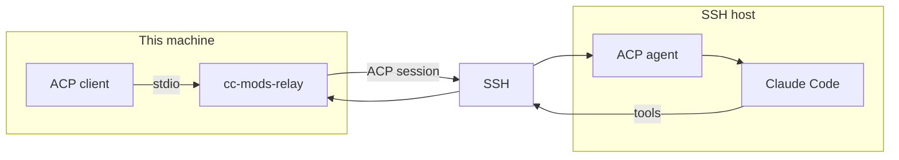
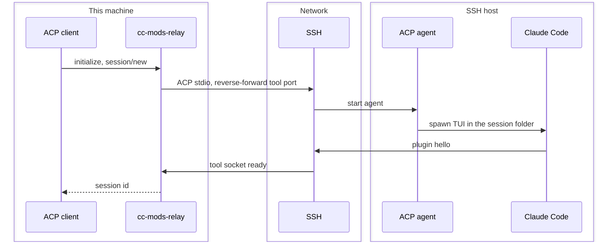

# cc-mods-relay

**Claude Code on an SSH host. Workspace tools stay on this machine.**

An [ACP](https://agentclientprotocol.com) client talks to this binary over stdio. The remote side hosts the interactive [Claude Code](https://code.claude.com) TUI. Read, Write, Edit, Glob, Grep, NotebookEdit, and Bash run against the local working directory.

## Architecture

Who runs where. ACP stdio and the tool socket share one SSH connection; they are not the same channel.



## Sequence



## Install

```sh
bun install
bun run compile
bun link
```

The SSH host needs `claude` and `bun`.

## Configure

```sh
mkdir -p ~/.config/cc-mods-relay
echo your-ssh-host > ~/.config/cc-mods-relay/host
```

The destination is `--host`, then `$CC_MODS_HOST`, then that file. Anything `ssh` accepts works.

Point an ACP client at this agent over stdio:

```sh
cc-mods-relay --host your-ssh-host
```

Without `--host`, the TUI and the tool executor both run locally.

```sh
cc-mods-relay doctor
```

## Session folder

The host session cwd follows the local project, flattened under `~/Workspace`:

| Local working directory | Host session cwd |
| --- | --- |
| `/Users/you/Workspace/app` | `~/Workspace/app` |
| your home directory | `~/Workspace` |

That folder looks like a normal checkout. `AGENTS.md`, `CLAUDE.md`, `CLAUDE.local.md`, and project `.claude/` skills and commands are copied there so Claude Code loads them at session start. File and shell tools still run on this machine; `session/new` `cwd` is the local path.

Session JSONL stays on the SSH host. Claude Code writes `~/.claude/projects/**/<session-id>.jsonl` there, same as a local Claude session. Project sync copies memory files and `.claude/` skills and commands, and excludes `.claude/projects`, `.claude/history.jsonl`, and `.claude/sessions`. Resume, fork, and list read those host files in place. Live ACP updates go over stdio; workspace tools use the forwarded socket. The transcript is not copied to this machine.

`~/.config/cc-mods-relay/config.json` can set `dir` (default `Workspace`). `ws` is `home` by default.

## Memory

The live path does not keep the session JSONL in RAM. The host agent tails new bytes on disk; once the plugin is connected, ACP events come from the tool socket. A full parse is only needed to resume or replay.

`session/close` and agent shutdown SIGTERM the TUI, then SIGKILL leftovers: bun PTY kills the process group, herdr closes the workspace it created. An `exit` hook reaps any remaining panes so they do not orphan.

Measured 12 Nov 2026 on darwin-arm64, Bun 1.4.4:

| Piece | Memory | Notes |
| --- | --- | --- |
| Tool relay (this machine) | 24 MB RSS, 0.8 MB heap | WebSocket tool executor; no JSONL |
| ACP agent on the host, session open | 78 MB RSS, 11 MB heap | No TUI in this sample. Claude Code is a separate process. |
| Parse and hold a 5.5 MB transcript | 12 MB heap, 7 ms | Same size as the largest host JSONL today. Not done while a session is live. |
| Host session JSONL on disk | 8 MB across 28 files | Mean 284 KB, largest 5.7 MB. Stays on the host. |

The compiled binary is about 95 MB on disk because it embeds the Bun runtime. That is file size, not resident memory. Idle Bun is 11 MB RSS.

## Tools

| Where | Tools |
| --- | --- |
| This machine | Read, Write, Edit, Glob, Grep, NotebookEdit, Bash, PowerShell |
| Copied to the host, then native | Artifact, DesignSync |
| Not run (no local executor yet) | LSP, Monitor, EnterWorktree, ExitWorktree, SendFile, SendUserFile |
| Host session | Agent, Skill, WebSearch, TodoWrite, and other session/cloud tools |

## Environment

`claude --append-system-prompt-file` (a Claude Code flag) adds the local working directory, git status, `AGENTS.md`, and `CLAUDE.md`. Credentials stay on the host TUI; they are not sent on the ACP wire.
